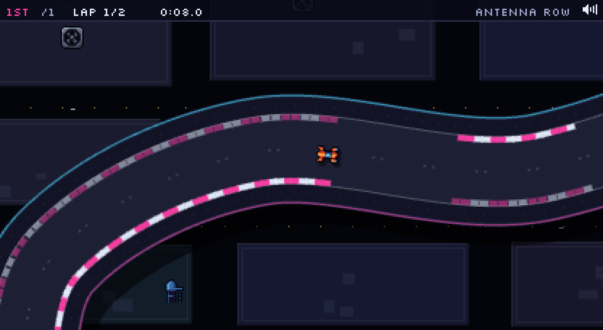

<div align="center">

# Pro Racer Z

**Hover racing on the rooftops of a neon city.**

A top-down arcade racer on raised circuits high above the streets. It runs in the browser with a keyboard, a controller or a touch screen.

### [▶ Play it now](https://leeeeeroyj.github.io/pro-racer-z/)

[](https://github.com/leeeeeroyj/pro-racer-z/actions/workflows/deploy.yml)


[](LICENSE)



</div>

## About

Pro Racer Z is an original arcade game inspired by the mechanics of Rare's 1988 NES game *R.C. Pro-Am*. You pilot a hover car round circuits built on the rooftops of a city at night.

- **A season of 24 races.** Eight circuits in three leagues: Neon, Storm (every track in reverse) and Blackout (the lights go down).
- **Four to a race.** You against three rival pilots, each with a way of driving: Halo, Vex and Dynamo. Finish in the top three to go on.
- **Darts and mines.** Fire darts that home in on the car ahead, or leave a mine behind you. A hit spins them out.
- **OVERDRIVE.** Collect the nine letters of OVERDRIVE, a few a race, to step up to a faster machine.
- **Upgrades that carry.** Thrusters, cores and grip kits stack up from race to race.
- **Free steering.** The car turns smoothly to any angle, and it slides a little through the bends, like a hovercraft.
- **A track above the city.** The streets and rooftops far below scroll slower than the track, so it feels high up.
- **A camera that looks ahead.** The view leads the car the way it's going, so you see the next bend sooner.
- **Sound with no audio files.** Sound effects are generated in code, sfxr style, when the game loads.

## How to play

**The season** is 24 races: the eight tracks in the Neon league, then the same eight in Storm, then in Blackout. Finish every race in the top three to win the **league crown**.

- **The pit board** comes before each race: the race number, league, track, laps and your lap record there, and everything you're carrying (machine, upgrades, score, charges, retries, Dynamo's heat and your letters).
- **4th place** costs a **retry**: the race runs again from where it started, and nothing you scored or picked up in it is kept. You start the season with 2. With none left, 4th place is **game over**.
- **The rivals** get a little quicker with each race in a league, and each league is quicker than the last.
- **High scores:** the best 8 seasons are kept in this browser, and the title shows the best. The table marks your entry with `>`.
- **Attract mode:** add `?attract` to the address for a silent demo that races itself, one race of the season after another, and ignores input. `?attract&seed=<n>` repeats the same demos.
- **Lap records** are kept per track and league. Beating one scores 1,000; your first lap on a track just sets it.

- **The screen:** the top bar shows your place, lap, race time, charges, score, the OVERDRIVE letters and your shield. Under it:
  - **top left,** your speed, your thruster, core and grip levels, and Dynamo's heat (his pips flash when he overdrives)
  - **top right,** the minimap: you're the pink arrow, the rivals are their initials (H, V, D), and a laser gate shows as a bar with a post at each end while it warns or fires
- **Reduced motion:** if your device is set to reduce motion, the screen doesn't shake or flash and there are fewer sparks.
- **The start:** four cars on the grid behind the chequered line. Three lights come on a second apart, then **GO**. You start on the second row.
- **The apron,** the dark strip between the white edge line and the wall, slows the car to 62 % of its top speed and makes it slide more.
- **The walls** stop you leaving the track. Hit one hard and you bounce off it.
- **Laps:** each lap time shows as you cross the line, and the last lap is called **FINAL LAP**.
- **The finish:** the others get a few seconds to cross the line, then the results board shows the order and the times, and whether you go on, retry or it's game over.
- **Charges** power your weapons. You start with 4 and can hold 9. Each dart or mine costs one.
- **Darts** fly ahead and bend toward the nearest car in front. **Mines** drop behind you and arm after half a second; until then they're harmless. Either one spins the car it hits for about a second.
- **Contact:** cars bump and push each other, but only weapons and hazards spin them.
- **The rivals** steer round slicks and coolant, and a rival who falls a long way behind you speeds up a little.
  - **Halo** is the quickest and takes the inside of every bend.
  - **Vex** moves across in front of you when you're close behind him.
  - **Dynamo** holds a grudge. Each rival you spin adds one heat; at five he overdrives at 1.3× his top speed for the rest of the race. His heat drops by one each race.
- **Letters:** each race lays out the next three letters of OVERDRIVE you still need. Letters you've collected stay collected between races. The top bar shows them: a solid tile for each one you hold.
- **OVERDRIVE:** the ninth letter steps you up to the next machine with fresh upgrades, and scores 25,000. In the Mk III it scores 50,000 and adds a retry instead.
- **Upgrades:** each kind goes up to 3 and stays with you between races until your next OVERDRIVE.
- **What carries to the next race:** your score, charges, machine, letters, upgrades, retries and Dynamo's heat.

**Machines**

| | Top speed | Acceleration | Turning | Grip |
| --- | --- | --- | --- | --- |
| Mk I Glider | 150 | 190 | 3.1 | 5.4 |
| Mk II Striker | 170 | 215 | 3.25 | 6.0 |
| Mk III Zenith | 190 | 240 | 3.4 | 6.6 |

You start in the Mk I.

**On the track**

| | |
| --- | --- |
| **Charge cell** | +2 charges, up to 9. Comes back 6 seconds after you take it, like every pickup except letters. |
| **Shield** | Soaks up the next spin, from a weapon or a hazard. A ring round your car shows it's on, and the shield icon in the top bar lights up. |
| **Thruster** | +10 % acceleration per level. |
| **Core** | +8 top speed per level. |
| **Grip kit** | Sharper turning and less slide, per level. |
| **Letter** | A pink tile with a letter on it. |
| **Boost pad** | Three bright chevrons. Drive over it for a burst to 1.35× top speed that eases off. |
| **Coolant spill** | A pale pool. Drive through it and your top speed drops to 60 % until it dries off, a moment after you leave it. |
| **Oil slick** | A black blot with a light rim. Drive on to it at speed and you spin. Storm adds more. |
| **Storm cloud** | Storm and Blackout. A cloud that drifts round the track, raining on the asphalt below it: top speed drops to 85 % and the car slides much more. |
| **Laser gate** | Blackout. Two posts across the track. Dashed lines blink for a second before the beam comes on; touch the beam and you spin. |
| **Drone** | Blackout. Sweeps from wall to wall with a dashed scan line. Touch it and you spin. |
| **Glitch skull** | Blackout. Drive into it and it eats 2 of your charges. |

| | Points |
| --- | --- |
| 1st / 2nd / 3rd | 5,000 / 3,000 / 1,500 |
| Spinning a rival with a dart or mine | 200 |
| Any pickup | 100 |
| Letter | 250 |
| Beating your lap record | 1,000 |
| OVERDRIVE | 25,000 (50,000 in the Mk III) |

**Tracks**

| | Laps in Neon / Storm / Blackout |
| --- | --- |
| Antenna Row | 2 / 2 / 2 |
| Coolant Bay | 3 / 3 / 3 |
| Billboard Bend | 2 / 3 / 3 |
| Helipad Loop | 3 / 3 / 3 |
| Night Market | 3 / 3 / 3 |
| Tower Nine | 3 / 3 / 3 |
| Static Heights | 3 / 3 / 3 |
| Zenith Spire | 3 / 3 / 3 |

## Controls

| | Keyboard | Controller | Touch |
| --- | --- | --- | --- |
| Turn | Left / Right, or A / D | D-pad | — |
| Point the way to go (the car turns to face it) | — | Left stick | The stick under your left thumb |
| Go | Up or W | A or RT | Push the stick further |
| Brake, then reverse | Down or S | B or LT | Let go to coast |
| Fire a dart | Z or Space | X | **FIRE** |
| Drop a mine | X or Shift | Y | **MINE** |
| Pause | P | Start | **II** (top right) |
| Start (title, pit board) | Enter or Space, or click **START** | A or Start | Tap **START** |
| Continue (results board) | Enter or Space, or click the pink button | A or Start | Tap the pink button |
| Sound on / off | M, or click the speaker (top right) | — | Tap the speaker |
| Back to the title | Esc, or click **TITLE** | Back | Tap **TITLE** (paused or on the results board) |

Controllers show up once you press a button. On a phone, play in landscape. The touch stick picks up wherever your left thumb lands on the left of the screen; on wide phones the stick and buttons sit in the bars beside the game. The race pauses itself if you switch away.

## Run it locally

You need [Node.js](https://nodejs.org/) 20.19+ or 22.12+.

```bash
npm install
npm run dev        # http://localhost:5173
npm run build      # type-check and build to dist/
```

Every push to `main` builds the game and deploys it to GitHub Pages.

## Project layout

```
src/
  main.ts            game setup
  config.ts          tunables: screen, track, machines, rivals, weapons, hazards, scoring
  data/tracks.ts     the tracks: control points, laps, pickups and hazards
  track.ts           the track spline, nearest-point lookup and lap crossing
  race.ts            one race: hover physics, rival driving, weapons, pickups, hazards, standings
  season.ts          the season: races, leagues, retries, the crown, the high-score table
  store.ts           high scores and lap records in localStorage
  rng.ts             seeded random numbers
  clock.ts           real-time frame steps
  bake.ts            the city, the track and the hazards, drawn in code
  trackView.ts       city parallax and the camera
  raceView.ts        cars, weapons, pickups and hazards on screen
  controls.ts        keyboard, controller and touch input
  sfx.ts             procedural sound effects
  motion.ts          the reduced-motion setting
  touch.ts           the touch stick and FIRE / MINE buttons
  attract.ts         the ?attract demo mode's settings
  scenes/            title with an attract race, pit board, race, HUD, final screen
assets/sprites/      the game's 16 × 16 sprites
design/              concept sheet and build plan
tools/sprites.py     sprite search and export script
tools/cdp.mjs        headless Chrome harness for the tests
tools/m*-test.mjs    checks for each milestone
tools/attract-test.mjs  checks for the ?attract demo
```

## Credits

- **Sprites:** from the CC0 [Angais/pixel-art-atlas-1.4m](https://huggingface.co/datasets/Angais/pixel-art-atlas-1.4m) dataset (AI-generated pixel art), found with [Pixel Search](https://huggingface.co/spaces/cfahlgren1/pixel-search).
- **Font:** [Silkscreen](https://fonts.google.com/specimen/Silkscreen) by Jason Kottke, SIL Open Font License.
- **Engine:** [Phaser](https://phaser.io/).
- **Inspiration:** *R.C. Pro-Am* (Rare, 1988). Pro Racer Z isn't affiliated with or endorsed by the original's rights holders.

## License

Code: [MIT](LICENSE). Sprites: CC0. Font: SIL OFL.
